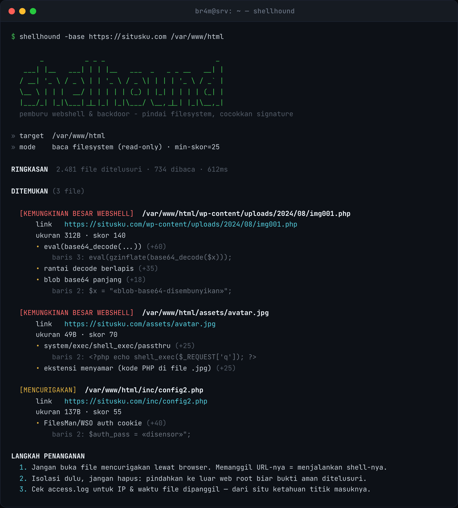

<div align="center">

# shellhound

### Pemburu webshell, backdoor & uploader PHP — baca langsung dari *filesystem*, bukan nebak dari luar



<p>
  
  
  
  
  
</p>

</div>

---

## Kenapa baca filesystem, bukan scan dari luar

> Webshell yang berhasil ditanam itu namanya acak (`x7g9.php`) atau menyamar jadi `avatar.jpg`. Dia nggak nongol di listing direktori dan nggak ketebak wordlist sepanjang apa pun.

Scanner yang nembak nama file dari luar lewat HTTP itu lemah untuk tujuan ini — dia cuma nemu yang namanya kebetulan ada di daftar. shellhound kerja **dari dalam**: dijalankan di server yang kamu kelola, lalu baca tiap file di web root langsung dari disk. Nama file nggak penting lagi; yang diperiksa **isinya**. File `avatar.jpg` yang ternyata berisi `<?php system(...)` tetap ketahuan, karena yang dilihat kodenya, bukan ekstensinya.

```diff
+ read-only  →  cuma membaca, menilai, dan melapor
- tidak ada file yang diubah, dipindah, atau dihapus
```

---

## Apa yang dideteksi

Tiap file PHP dicocokkan dengan beberapa kelompok indikator, lalu diberi skor:

| Kategori | Contoh yang ditangkap | Bobot |
|---|---|:---:|
| **Signature keluarga shell** | c99, r57, b374k, WSO/FilesMan, Alfa, IndoXploit | `+55` |
| **Fungsi eksekusi berbahaya** | `eval`, `assert`, `system`, `exec`, `shell_exec`, `passthru`, `preg_replace /e` | `+25…55` |
| **Obfuscation** | `eval(gzinflate(base64_decode()))`, rantai decode berlapis, blob base64 panjang, deret `chr()` | `+15…60` |
| **Kemampuan upload** | `move_uploaded_file`, tulis file dari input user | `+20…25` |
| **Ekstensi menyamar** | kode PHP di dalam `.jpg`, `.ico`, `.txt` | `+25` |
| **Input user → sink** | `$_GET`/`$_POST`/`$_REQUEST` berdekatan dengan fungsi berbahaya | `+20` |

> Nilai yang mirip password atau payload base64 **disensor** di laporan, jadi bukti bisa dibaca tanpa ikut menyebarkan rahasianya.

---

## Instalasi

<details open>
<summary><b>Unduh binary jadi (paling gampang)</b></summary>

Ambil dari halaman **[Releases](https://github.com/b3n3d1ck/shellhound/releases)** — ada buat Linux, Windows, macOS. Ekstrak, taruh di server, jalankan. Nggak perlu install apa-apa.
</details>

<details>
<summary><b>Lewat Go</b> (butuh Go 1.21+)</summary>

```bash
go install github.com/b3n3d1ck/shellhound@latest
```
</details>

<details>
<summary><b>Build dari sumber</b></summary>

```bash
git clone https://github.com/b3n3d1ck/shellhound.git
cd shellhound
go build -o shellhound .
```
</details>

---

## Pemakaian

```bash
shellhound /var/www/html                               # scan satu web root
shellhound -base https://situsku.com /var/www/html     # sekalian petakan ke link publik
shellhound -all-ext -min 20 /var/www/html              # periksa semua file, lebih sensitif
shellhound -json -o lapor.json /var/www/html           # simpan laporan JSON
```

| Opsi | Arti | Default |
|---|---|---|
| `-ext` | ekstensi yang diperiksa | `php,php3,php4,php5,php7,phtml,pht,phar,inc` |
| `-all-ext` | periksa semua file teks, bukan cuma PHP | `off` |
| `-min` | skor minimum untuk dilaporkan | `25` |
| `-base` | URL dasar → link yang bisa diklik per temuan | `—` |
| `-max-size` | lewati file lebih besar dari sekian MB | `3` |
| `-skip` | folder yang dilewati | `.git,node_modules,.svn,.hg` |
| `-c` | worker paralel (0 = otomatis) | `0` |
| `-json` / `-o` | keluaran JSON ke layar / ke file | `—` |

> `-base` bikin tiap temuan langsung kasih URL yang bisa diklik, gampang dicocokkan sama log akses. Kalau ada temuan, **exit code-nya `1`** — jadi bisa langsung dijadiin alarm di cron atau CI.

---

## Tingkat keyakinan

Hasil dikelompokkan jadi tiga tingkat berdasarkan skor:

| Skor | Label | Artinya |
|:---:|---|---|
| `≥ 70` | **KEMUNGKINAN BESAR WEBSHELL** | pola shell yang kuat, periksa segera |
| `45–69` | **MENCURIGAKAN** | kemungkinan besar jahat, perlu dipastikan |
| `25–44` | **PERLU DITINJAU** | ada indikator, bisa jadi kode sah — lihat potongannya |

Tiap temuan selalu disertai **nomor baris + potongan kode pemicunya**, jadi kamu menilai sendiri, bukan percaya buta ke skornya.

---

## Kalau ada yang ketangkap

1. **Jangan buka file-nya lewat browser.** Memanggil URL-nya = menjalankan shell-nya.
2. **Isolasi, jangan langsung hapus.** Pindahkan ke luar web root (`mv shell.php /root/karantina/`) biar bukti aman ditelusuri.
3. **Cek `access.log`** untuk IP dan waktu file dipanggil — dari situ ketahuan titik masuknya.
4. **Cari file lain yang baru dimodif:** `find /var/www -type f -mmin -1440 -name '*.php'`.
5. **Ganti semua kredensial** — DB, API key, panel admin, SSH.

### Cara nutup celahnya

| Langkah | Caranya |
|---|---|
| Matikan eksekusi PHP di folder upload | Nginx: `location ~* /uploads/.*\.php$ { deny all; }` · Apache: `php_admin_flag engine off` |
| Batasi fungsi berbahaya | `disable_functions = exec,passthru,shell_exec,system,proc_open,popen,assert` |
| Kurung skrip | pasang `open_basedir` ke direktori aplikasi |
| Perbarui CMS/plugin/tema | pintu masuk shell paling umum |
| Validasi upload by isi | cek MIME + magic bytes, bukan cuma ekstensi |

---

## Scan otomatis harian

Pasang di crontab, kirim email kalau ada yang ketangkap:

```cron
0 3 * * * /usr/local/bin/shellhound /var/www/html || mail -s "shellhound: temuan di web root" admin@situsku.com < /dev/null
```

---

## Batasan

Deteksinya berbasis signature dan heuristik, jadi dua hal perlu diingat:

- Shell dengan teknik atau obfuscation yang **belum dikenal bisa lolos** — skor bersih bukan jaminan mutlak.
- Kode sah yang kebetulan pakai `exec` atau `base64_decode` bisa muncul sebagai "perlu ditinjau" — makanya tiap temuan selalu bawa potongan kodenya.

> Alat ini **mempercepat** pemeriksaan, bukan menggantikan mata manusia.

---

## Izin & hukum

shellhound membaca filesystem, jadi secara alami dipakai di server yang **kamu punya aksesnya sendiri**. Tetap: jalankan hanya pada sistem yang kamu miliki atau yang kamu diberi izin tertulis untuk diperiksa.

## Kontribusi

Yang paling berguna: signature webshell baru dan pola obfuscation yang belum tertangkap. Tambahkan di `signatures.go`, lengkapi tesnya (`go test ./...` harus lolos), kirim pull request. Alat ini sengaja dijaga sebagai scanner **defensif** — ia melapor, tidak mengeksploitasi.

## Lisensi

[MIT](LICENSE) © 2025 Mas Bram
